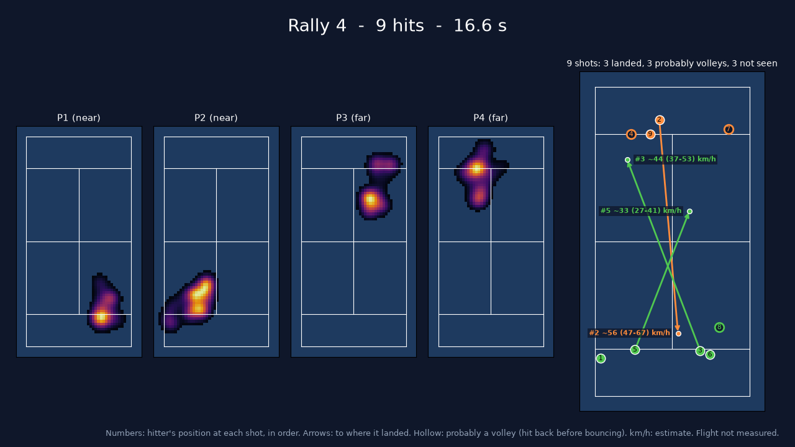

# PadelVision

**Computer-vision analytics for padel matches filmed with a single fixed camera.**

PadelVision turns a match video into player movement statistics, court heatmaps, rallies, shot maps and
automatically cut highlight videos. It is built around a hard but common case: an amateur recording from a
low, wide-angle camera (a GoPro or phone) standing behind one baseline, with lens distortion, a compressed far
court and a ball that is often only a few pixels wide.

> Personal / portfolio project, rebuilt from scratch (V2). The design principle throughout is **measure, don't
> invent**: when something can't be measured reliably, the output says so instead of showing a plausible-looking
> number.

<p align="center">
  
  <br><em>A rally summary card from a highlights video: where each player moved during the rally, every shot in
  order, where it landed, and a speed estimate with its error range.</em>
</p>

---

## What it does

| Area | Output |
|---|---|
| **Players** | Detection and tracking of the four players; spectators, coaches and people behind the glass are filtered out; four stable identities (two per side of the net) |
| **Movement** | Distance covered, average and peak speed, sprints, time in the net / transition / back zones, team formation, partner spacing |
| **Heatmaps** | Court-coverage heatmap per player, for the whole match and per rally |
| **Ball** | A custom-trained ball detector and a tracker that picks the *ball in play* among spare balls, balls in hand and balls on neighbouring courts |
| **Events** | Hits (with the hitter), floor bounces (with their court position), ball handling between points, and probable volleys |
| **Rallies** | Points detected from the exchange of hits; rally length, hits per rally and per player |
| **Shots** | Shot map (hitter → landing point), placement by zone, and a shot-speed estimate with an error range |
| **Video** | Annotated preview, a **highlights** video of the best rallies, and a **condensed match** with the dead time removed, each with a live stats overlay and a summary card after every rally |

Everything is computed from one camera: no wearables, no multi-camera rig, no manual tagging.

## How it works

The pipeline is a chain of small stages. Each stage reads the previous stages' files and writes its own to a
run folder, so any stage can be re-run, inspected or tuned on its own.

| # | Stage | Method | Output |
|---|---|---|---|
| 0 | Probe | Frame rate, resolution and duration read from the video (never assumed) | `video.json` |
| 1 | Court calibration | Lens-distortion model plus a homography fitted to court lines, so curved GoPro lines work and the near corners don't need to be visible | `court.json` |
| 2 | Player detection | YOLO11 person detector + ByteTrack | `detections.parquet` |
| 3 | Identities | Keeps people whose feet are on the court; assigns four stable slots with physical-plausibility gating | `players.parquet` |
| 4 | Ball | Fine-tuned YOLO11s ball detector; tracklet linking; selection of the ball in play; short gaps filled, long gaps left empty | `ball.parquet` |
| 5 | Events and rallies | Sharp turns of the ball's path, classified by who could reach the ball (checked against the ball's apparent size, i.e. its depth) and by its motion | `events.parquet`, `rallies.json` |
| 6 | Analytics | Kalman-smoothed player tracks → movement stats; rally, placement and shot statistics | `stats.json` |
| 7 | Visuals and video | Heatmaps, placement map, preview, highlights and condensed match | `*.png`, `*.mp4` |

### Principles

- **No fabricated data.** A metric that can't be computed is reported as *insufficient data*, never filled in.
- **Ground-plane geometry only where it's valid.** Court positions come from the homography only for points on
  the ground (feet, bounces). An airborne ball is never projected onto the court.
- **Honest estimates.** A shot speed is shown only when its landing was clearly tracked and its error range is
  within ±25%. It is labelled as an estimate (the average ground speed from the hitter to the bounce, a lower
  bound for the speed off the racket), always with its range.
- **Uncertainty is reported.** Calibration accuracy is reported per court zone, and each shot without a landing
  says why ("probably a volley" or "landing not seen").
- **Reproducible models.** Every model is listed in `models/manifest.yaml` with a URL and SHA-256 and is
  downloaded by a script. Weights are never committed.

## Current results

Measured on two real videos: a 3.5-minute clip and a 19-minute match at a different club. Numbers come from visual
review unless stated otherwise; see [`ml/eval/README.md`](ml/eval/README.md) for methods and label files.

| Metric | Result |
|---|---|
| Court calibration, expected ground error (near half / net / far half) | 0.02–0.04 m / 0.11–0.25 m / 0.3–0.7 m |
| Player tracking coverage on the 19-minute match | 85–87% of the time per player |
| Player identity switches | 0 in 94 s reviewed |
| Ball detector (held-out blocks, 10 px tolerance) | recall 0.74, precision 0.85, F1 0.79 |
| Detected hits inside rallies that are real hits | 17 of 17 decided |

**Known limitations.**
- **Ball detection on new courts.** On the second club the ball is found on only about a third of the frames, so
  rallies come out as fragments. A retraining notebook for new courts exists ([`09_retrain_ball`](ml/notebooks)).
- **Unmeasured recall.** Hit and bounce recall have not been measured yet: that needs exhaustive hand labels; the
  labelling tool is included.
- **No shot types yet.** Shots are not classified (smash, lob, volley).
- **Side slots, not people.** Player identities are side slots and don't follow a specific person across end
  changes.

## Quick start

### Local (development, tests, re-running the light stages)

Requires Python ≥ 3.10. No GPU is needed: the unit tests use tiny synthetic fixtures.

```bash
python -m venv .venv
.venv/Scripts/python -m pip install -e "pipeline[dev]"      # macOS/Linux: .venv/bin/python
.venv/Scripts/python -m pytest pipeline
.venv/Scripts/python scripts/fetch_models.py                 # download + verify the model weights
```

Stages 3–7 run on a laptop CPU from a run folder produced on a GPU, so tuning doesn't require re-processing the
video:

```bash
padelvision restats      runs/match1    # identities, movement stats, heatmaps
padelvision ball-retrack runs/match1    # ball tracking from cached detections
padelvision events       runs/match1    # hits, bounces, rallies, shot stats, placement map
```

### Full matches (Kaggle or Colab, GPU)

Model inference runs in notebooks on a free Kaggle (preferred) or Colab GPU. Each notebook clones the repo,
installs the package and fetches the weights itself.

| Notebook | Purpose |
|---|---|
| [`08_full_match`](ml/notebooks/08_full_match.ipynb) | **End to end:** downloads a match from Google Drive, converts it to the working format, checks the court calibration, runs every stage, and exports stats, images, highlights and a condensed match |
| [`07_highlights`](ml/notebooks/07_highlights.ipynb) | Highlights from an existing run, no GPU or re-detection needed |
| [`06_events`](ml/notebooks/06_events.ipynb) | Events, rallies and review material for checking them by eye |
| [`09_retrain_ball`](ml/notebooks/09_retrain_ball.ipynb) | Fine-tunes the ball detector on a new court, compares old and new models, and builds an evaluation pack |
| `00`–`05` | Setup check, player analytics, ball label bootstrap, detector bake-off, ball training, ball tracking |

A new camera position needs a court calibration once (`padelvision calibrate frame.png -o court.json`).
Calibrations live in `ml/calibrations/<video name>.json` and are picked up automatically.

## Command line

```text
padelvision probe <video>                                   video metadata
padelvision calibrate <frame.png> -o court.json             interactive court calibration
padelvision analyze <video> --court court.json --out RUN    stages 0-3, 6-7 (players)
padelvision ball-track <video> --run RUN                    stage 4 (ball)
padelvision events RUN                                      stage 5 + rally stats
padelvision render <video> --run RUN --start 0 --seconds 30 annotated preview with stats overlay
padelvision highlights <video> --run RUN [--mode top|all] [--top 5]
padelvision restats RUN | ball-retrack RUN                  re-run light stages from cached detections
padelvision ball-bootstrap | ball-review-pack | label-ball  ball label bootstrap and review
padelvision event-review-pack | label-events | events-eval  hit/bounce labelling and scoring
```

## Project structure

```
pipeline/              padelvision Python package (CV and analytics core) + tests
  src/padelvision/
    court/             geometry, lens model, calibration, calibration tool, drawing
    models/            model registry and detector interfaces (the only place that imports Ultralytics)
    players/           detection, on-court filtering, identities
    ball/              label bootstrap, dataset building, evaluation, ball tracking
    analytics/         movement and rally statistics
    events.py          hits, bounces, handling, rallies
    visuals.py         heatmaps, placement map, rally summary cards
    render.py, overlay.py, highlights.py   preview, stats overlay, highlights
    run.py, cli.py     stage orchestration and command line
ml/
  notebooks/           Kaggle/Colab notebooks 00-09
  calibrations/        court calibrations per video
  eval/                evaluation method, label files and current numbers
models/manifest.yaml   every model with URL, SHA-256, licence and metrics
docs/                  V2 plan, model cards
scripts/               fetch_models.py
```

## Models

| Name | Model | Use |
|---|---|---|
| `person-detector` | YOLO11s (COCO) | player detection |
| `ball-detector` | YOLO11s fine-tuned on padel balls | ball detection; see the [model card](docs/models/padel_ball_yolo11s.md) |

Weights are downloaded by `scripts/fetch_models.py` and verified against their SHA-256. All model access goes
through one interface, so another detector can be swapped in.

## Development

```bash
.venv/Scripts/python -m pytest pipeline         # unit tests (no weights or GPU)
.venv/Scripts/ruff check pipeline scripts       # lint
.venv/Scripts/ruff format pipeline scripts      # format
```

Conventions: Python ≥ 3.10 with type hints; each stage reads and writes files in the run folder; tuning constants
sit at the top of each module.

## Roadmap

- Retrain the ball detector across courts, then measure hit and bounce recall with exhaustive labels
- Shot types (pose plus ball trajectory)
- A local web app: FastAPI backend plus a Next.js dashboard with overlays drawn on the original video

The full plan is in [`docs/V2_PLAN.md`](docs/V2_PLAN.md).

## Licensing and credits

- **Ultralytics YOLO11** (AGPL-3.0) is used for detection, which suits a non-commercial, open project.
- **Ball training data:** the developer's own footage plus Roboflow Universe datasets (CC BY 4.0); see the
  [model card](docs/models/padel_ball_yolo11s.md) for sources.
- **Videos:** never part of the repository.
